# Atmos: sky, weather and water for Bevy

**bevy_atmos** gives a Bevy 0.19 game a living outdoor look in one plugin
line. It adds:

- a time of day that moves the sun
- a physical sky with volumetric clouds
- sun shafts and distance fog
- rain and snow that soak the ground into puddles
- modern water with waves, foam and flowing rivers
- a final colour grade

You tune all of it live, in game, from a beginner-friendly editor panel
(F9). Start from a preset like *Golden Hour* or *Storm*, tweak it, and save a
look per level as a small text file. It's free and open source (MIT or
Apache-2.0).

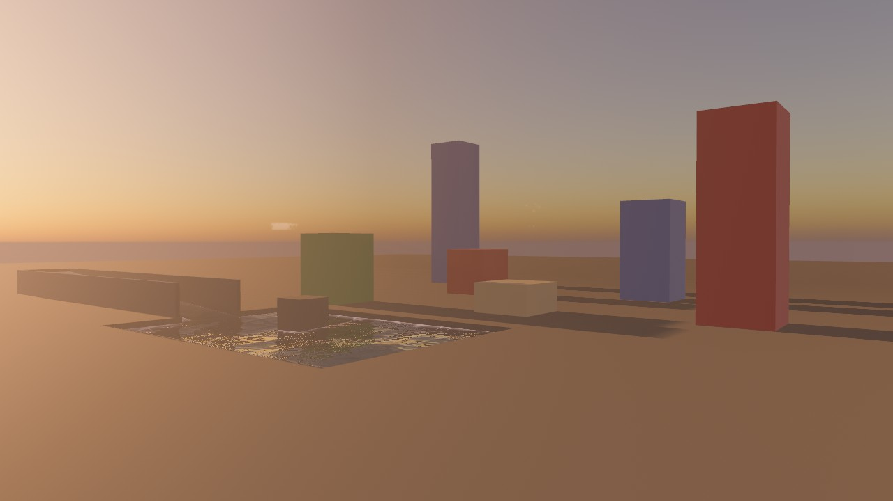

## Features

### A look editor anyone can use

Press **F9** in your game. Seven tabs (Time & Sun, Sky & Clouds, Weather,
Water, Fog & Light, Shadows, Colour) hold the everyday settings, with the
rest under *Advanced*.

- Every slider says what it does and shows its unit, and one click resets it.
- Pick a preset, then tweak it.
- Hold *Compare* to see the level without your look, then *Save*.
- The status line always says which level's look is loaded and whether it
  has unsaved changes.
- It works with a mouse, the keyboard or a gamepad.

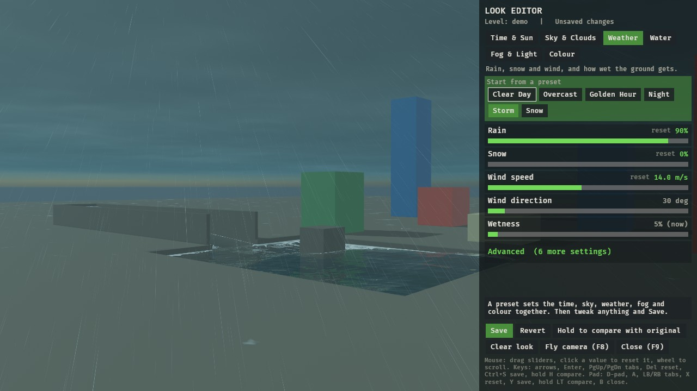

### Time of day and sun

Set the hour, or let the clock run. The sun follows a real path for your
latitude, and the moon lights the night. You can also pin the sun anywhere
for a shot.

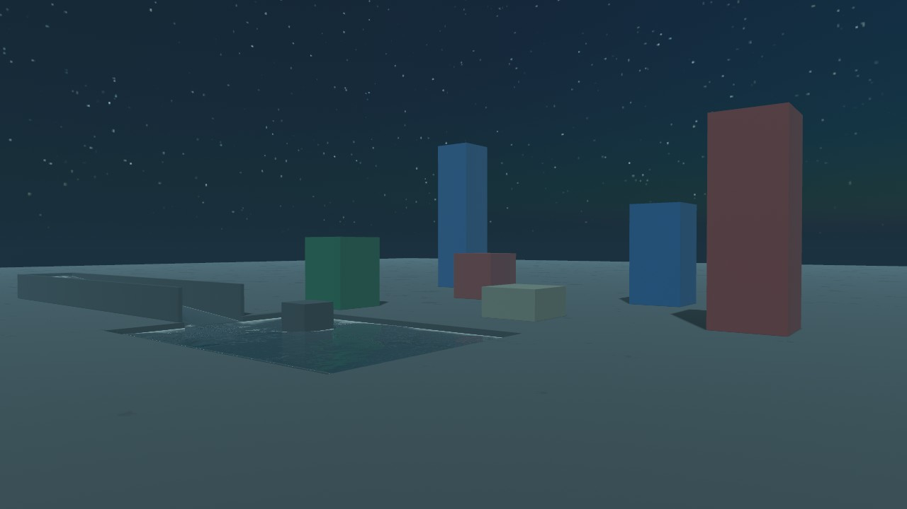

### Sky and volumetric clouds

A physical sky whose colours follow the sun, with 3D clouds raymarched per
pixel: small cumulus mixed with a few big towering ones, grouped in large
regions so the sky doesn't repeat toward the horizon. Cover, greyness, wispiness, height and drift are all sliders, and
*Cloud quality* (Off, Low, Medium, High) trades looks for speed. The same
clouds light the scene and show in its reflections.

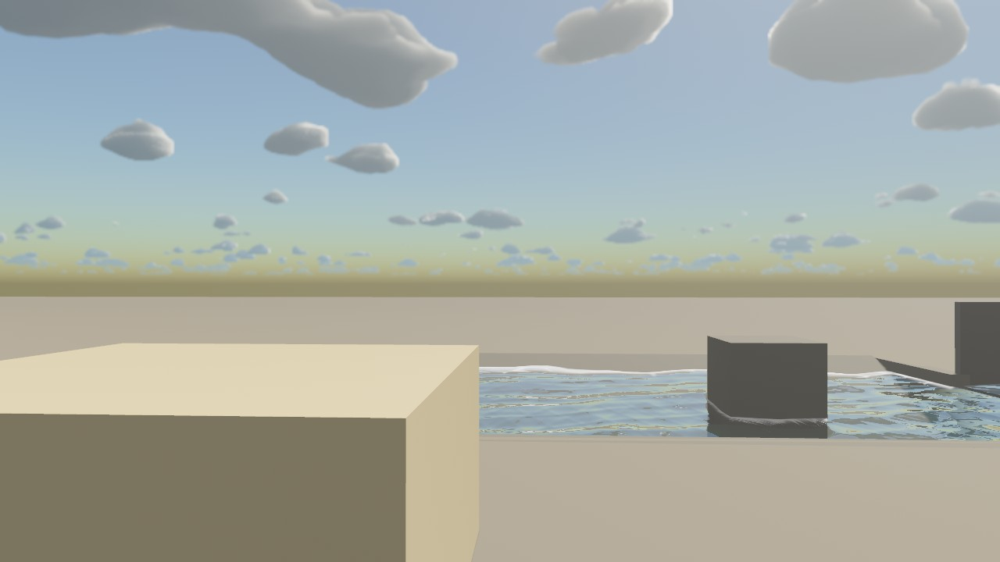

### Rain, snow and wet surfaces

Rain and snow fall round the camera and slant in the wind. Surfaces with
`WetMaterial` darken as they soak and collect puddles. The puddles ripple in
the rain and dry slowly after.

| Storm | Snow |
|---|---|
| 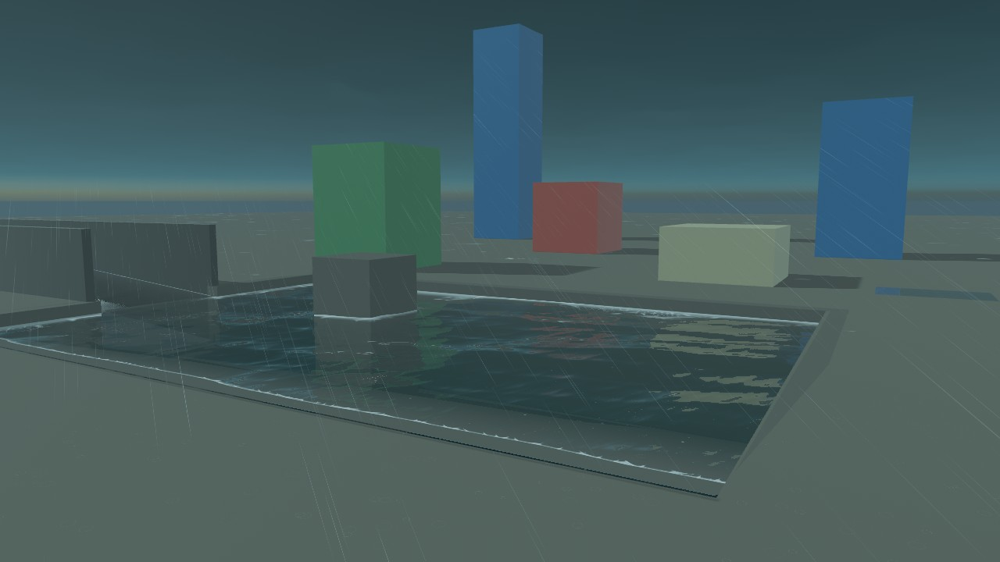 | 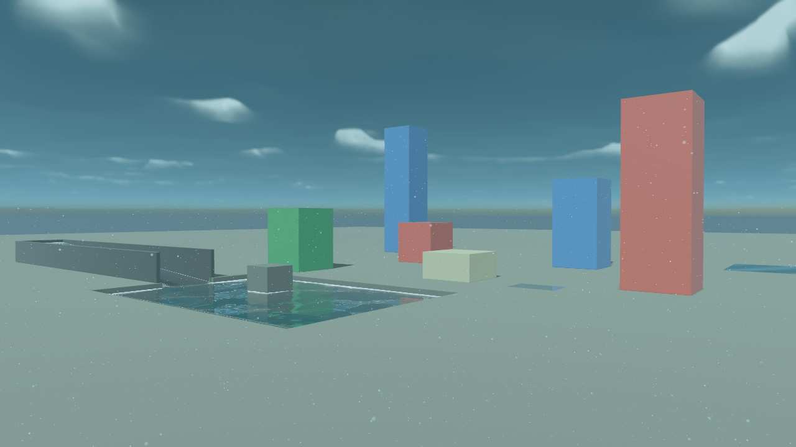 |

### Modern water and rivers

**Atmos finds your water by itself.** Any mesh whose name, glTF mesh name or
glTF material name contains *water*, *sea*, *ocean*, *river*, *lake*,
*pool*, *pond*, *canal* or *puddle* becomes water, and a sloped one becomes a
river flowing downhill. If yours is named something else, you can:

- click it with the editor's **Mark water** tool (Water tab; saved with the
  level's look),
- or tag it in code: `commands.entity(water_mesh).insert(AtmosWater)`.

The Water tab says what it found ("3 by name, 1 marked by hand"), or tells
you when a level has none. Atmos draws the water it finds as modern water
(*Modern water* on the Water tab, on by default; turn it off to keep your
own):

- waves that follow the wind
- shore and wave-top foam
- sky and screen reflections, and sun glitter
- rain rings and underwater fog

Each surface is a **puddle**, **pond**, **river** or **sea**, worked out from
its name and shape (a long, narrow or winding outline makes a river) (or set with `WaterKind`, or the Mark water tool's kind
picker). Puddles stay still and mirror the world, ponds get small waves,
seas get swells, and waves scale with the body's size.

| Puddle: still and mirror-like | Pond: found by its name, no tags |
|---|---|
| 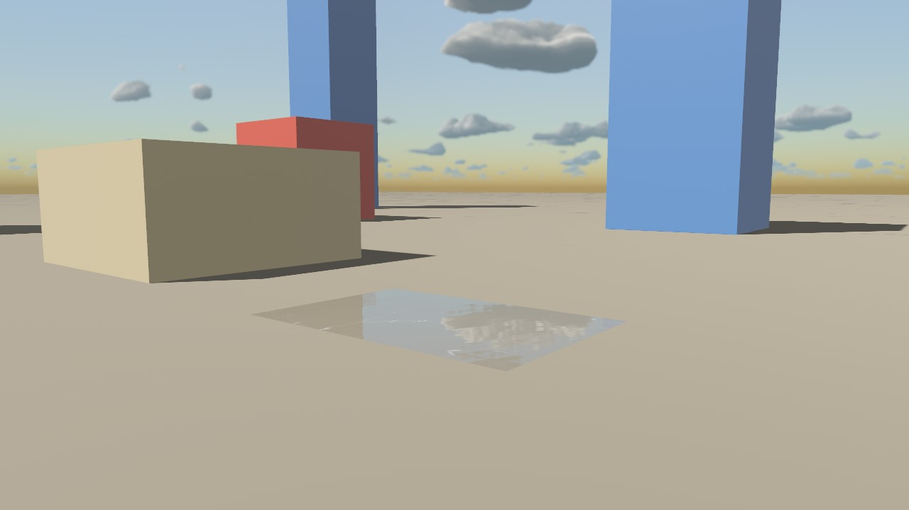 | 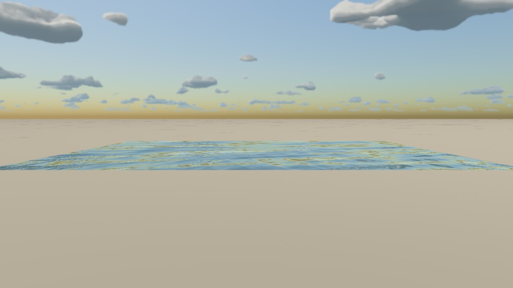 |

Add `WaterFlow` (or let a sloped mesh be found as a river) and a river flows downhill.
Rivers carry some silt by default (*River silt*), so they look like rivers
rather than pools. It breaks into white water on
fast stretches and leaves foam trails behind rocks. You can also paint flow
by hand in the editor.

| Rough water with crest foam | Shoreline foam |
|---|---|
| 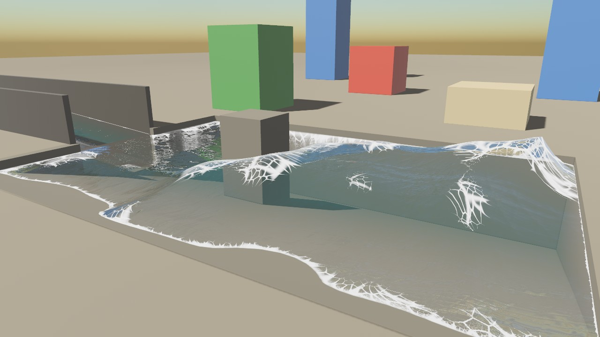 | 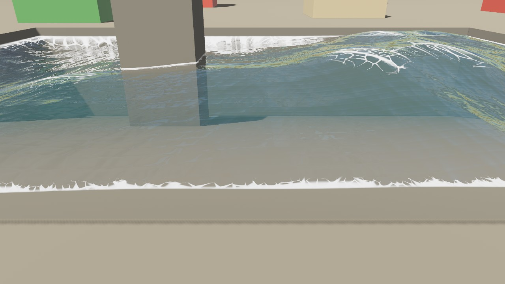 |

| River: foam trailing a rock | River: low sun, looking downstream |
|---|---|
| 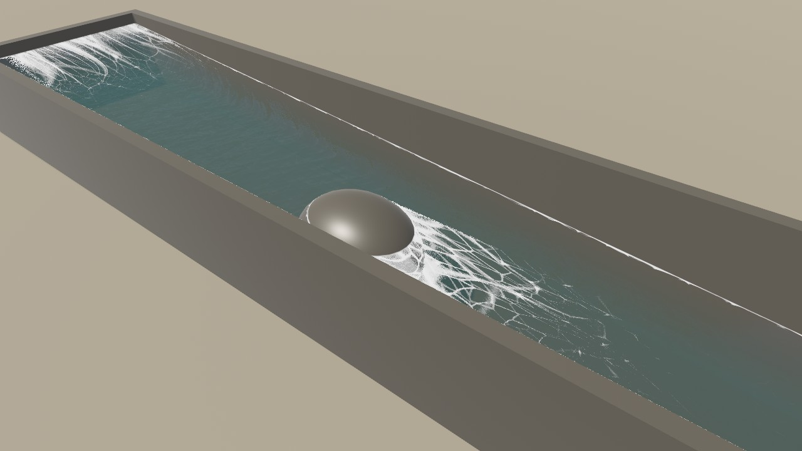 | 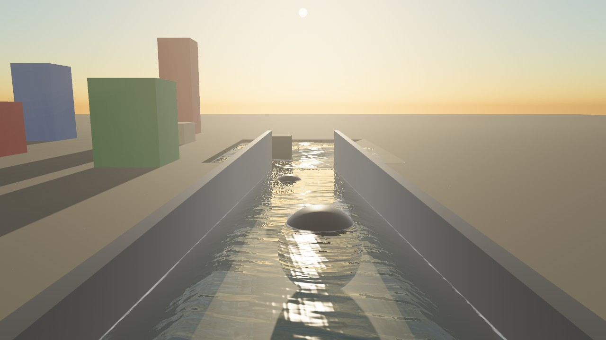 |

### Fog, sun shafts and reflections

- Distance fog tinted by the sky.
- Beams of sunlight through the haze.
- Screen-space reflections on wet ground and shiny floors.

### Shadows and ambient occlusion

Shadow darkness, softness and reach, contact shadows where things meet the
ground, and screen-space ambient occlusion, saved per level like the rest.
Each setting starts *unset*, which leaves your game's own shadow setup
exactly as it was until you change it. Ambient occlusion can also darken
sunlit corners, not only shaded ones (*Occlusion in sunlight*).

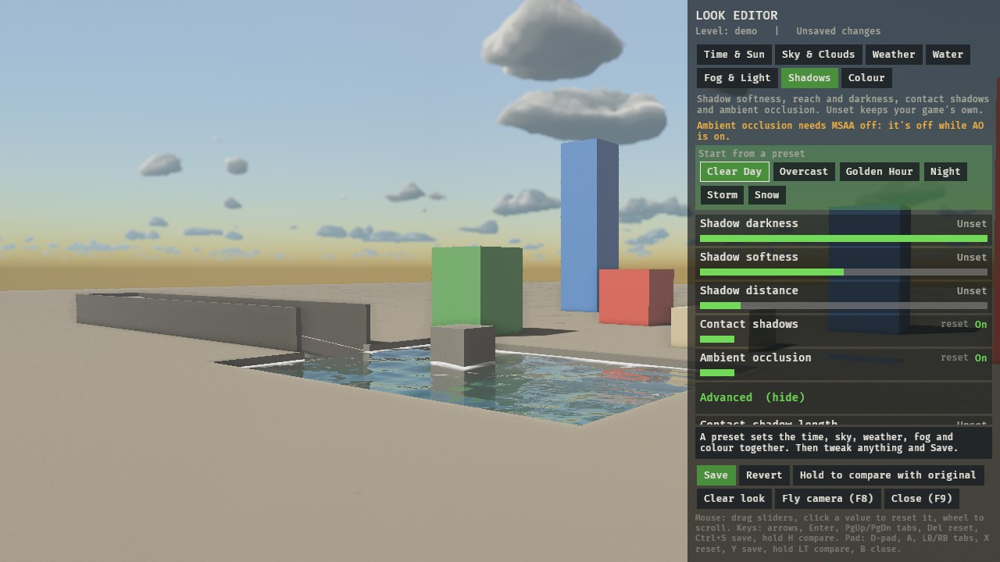

### Colour grade

Exposure, warmth, tint, contrast and saturation, applied as the last step.

## Requirements

- **Bevy 0.19**: the plugin depends on `bevy = "0.19.1"`.
- **Rust**: a recent stable toolchain (edition 2024). Install it from
  [rustup.rs](https://rustup.rs).
- **A GPU with compute shaders**: anything that runs Bevy's default renderer
  on Vulkan, DirectX 12 or Metal.
  - WebGL2 is not supported, because the clouds and the sky use compute
    passes.
  - The camera should be `Hdr`.

## Install

1. Add it to your game's `Cargo.toml`:

   ```toml
   [dependencies]
   bevy_atmos = { git = "https://github.com/Nilbong/bevy_atmos", tag = "v0.2.0" }
   ```

2. Add the plugin (one line). That's all most games need: Atmos uses your
   3D camera, your brightest directional light as the sun, and finds water
   by name.

   ```rust
   use bevy::prelude::*;
   use bevy_atmos::AtmosPlugin;

   fn main() {
       App::new()
           // The level's name, and the folder its saved look goes in.
           .add_plugins((DefaultPlugins, AtmosPlugin::new("my_level", "looks")))
           .add_systems(Startup, setup)
           .run();
   }

   // Your game's own camera and sun, as they are (Hdr recommended).
   fn setup(mut commands: Commands) {
       commands.spawn((Camera3d::default(), bevy::camera::Hdr));
       commands.spawn(DirectionalLight { shadow_maps_enabled: true, ..default() });
   }
   ```

   The log says what it picked (`bevy_atmos: using the only 3D camera ...`).
   With several cameras or lights, tag the ones you mean (see
   [Integration](#integration)).

3. Run your game and press **F9**.

To try it before adding it to a game, clone the repo and run the demo:

```sh
git clone https://github.com/Nilbong/bevy_atmos
cd bevy_atmos
cargo run --release --example demo
```

## Getting started

| Key | What it does |
|---|---|
| **F9** | Opens and closes the look editor. While it's open, the mouse pointer belongs to the panel. |
| **F8** | The fly camera: WASD to move, Space/E up, Ctrl/Q down, mouse to look, wheel for speed, Shift to go faster. Pad sticks and triggers work too. |

If your game already uses F9 or F8, pick other keys:
`AtmosPlugin::new("my_level", "looks").with_keys(KeyCode::F10, KeyCode::F11)`.

### Using the editor

- **Presets**: Clear Day, Overcast, Golden Hour, Night, Storm and Snow. Each
  one sets the time, sky, weather, fog and colour together. Start from one,
  then change anything.
- **Sliders**: drag them.
  - A changed value turns green and gets a *reset* link. Click it (or the
    value) to go back to the default.
  - Hover a slider to read what it does.
- **Advanced**: each tab's extra settings, such as cloud quality, rain
  streaks, foam and reflections.
- **The buttons along the bottom**:
  - **Save** writes the level's look.
  - **Revert** goes back to the last save.
  - **Hold to compare with original** shows the level with no look at all.
  - **Clear look** starts from scratch.
- **Keyboard**: arrows, Enter, PageUp/PageDown for tabs, Delete to reset,
  Ctrl+S to save, hold H to compare.
- **Gamepad**: Back + D-pad down opens the editor. Then D-pad, A, LB/RB for
  tabs, X to reset, Y to save, hold LT to compare, B to close.

### Where looks are saved

`AtmosPlugin::new(level, save_dir)` saves to `<save_dir>/<level>.txt`,
relative to the folder the game runs from. It's a plain text file you can
read, diff and commit:

```
# my_level's look (bevy_atmos)
time.hour = 17.5
sky.cover = 0.6
weather.rain = 0.4
```

Only the values you changed are written. Everything else stays at its
default, so a level without a saved look looks exactly as your game made it.

- **Changing level**: set the `AtmosLevel` resource to the new level's name
  and its look loads.
- **Shipping looks with your game**: pass them as `AtmosSettings::builtin`
  (`include_str!` of the files). A file in the save folder wins over a
  built-in one.

## Integration

**Most games need nothing beyond the plugin line; tag things only to
override.**

What Atmos sets up by itself:

- **Camera**: with no `AtmosCamera` tagged and exactly one `Camera3d`, that
  one.
- **Sun**: with no `AtmosSun` tagged, the brightest `DirectionalLight`.
- **Water by name**: meshes whose `Name`, glTF mesh name or glTF material name
  (their own or their parent's) contains one of the water words. They get
  `AtmosWater`, `OwnMesh` and `WaterTint` from their material; sloped ones
  flow downhill. Change the words with `AtmosPlugin.water_words`.
  The editor's *Find water automatically* toggle (`water.auto`) turns this off.
- **Water by look** (off by default, *Guess water from materials*,
  `water.guess`): flat, level, smooth or see-through blue-green surfaces.
  It can catch glass, so check what it finds.
- **Rain under roofs**: while it rains or snows, a look straight down over
  the player finds roofs, awnings and trees, so rain stays outdoors (see
  *Shelter map* below).
- **Water marked by hand**: the editor's *Mark water* tool, saved per level as
  `water.mark.<name> = 1` (or `0`: never water). Its kind picker (Puddle, Pond,
  River, Sea) sets a surface's kind instead, saved as `water.kind.<name>`
  (1 puddle, 2 pond, 3 river, 4 sea).
- **Water kinds**: each surface is a puddle, pond, river or sea, from its
  `WaterKind` tag, a kind set by hand, its name, then its shape (small:
  puddle; long and narrow or sloped: river; huge: sea; otherwise pond). Waves
  scale with the body's size, and rivers flow along their length.

Tags that override it (your own tags are left alone):

| Tag | What it does |
|---|---|
| `AtmosCamera` | The camera the look applies to. |
| `AtmosSun` | The `DirectionalLight` that is the sun. |
| `modern_water::AtmosWater` | This mesh is water. |
| `modern_water::OwnMesh` | Draw the water on this mesh's own shape (any shape, several pools in one mesh; the waves are in its normals, nothing is displaced) instead of a flat grid over its bounds. |
| `modern_water::WaterTint(colour)` | The water's colour, in place of the *Water colour* slider. |
| `modern_water::WaterDepth(m)` | Colour and foam a thin sheet of water (a puddle decal, a shallow pool surface) as if it were at least this deep. |
| `modern_water::WaterKind` | What kind of water this is: `Puddle` (still, mirror-like, rain rings only), `Pond` (small waves), `River` (flows along its length) or `Sea` (swells). Without it, Atmos works the kind out from the name, then the size and shape. |
| `modern_water::FadeEdges` | Fade the water out by the mesh's vertex-colour alpha (off by default: many games use that alpha for something else, and it can leave the water in squares). |
| `flow::WaterFlow` | A river, and which way it flows (below). |

More you can add:

| What | How |
|---|---|
| **Wet surfaces** | Use `wet::WetMaterial` (a `StandardMaterial` extension) on surfaces that can get wet. `Wet::ground()` is for floors that collect puddles, `Wet::surface()` for walls and props. `Wet::new(allow, puddles)` lets you choose (allow 0: never wet). |
| **Water** | With *Modern water* on (Water tab, the default), Atmos hides your water mesh and draws modern water in its place. Turn it off and your own water shows again. If you have no water material, `water::water_material(colour)` makes a simple one. |
| **Rivers** | Add `flow::WaterFlow` beside `AtmosWater`. The water then keeps the mesh's own (sloped) shape and flows. Give it the direction in one of four ways: `WaterFlow::uv_scroll(scroll)` (your water texture's scroll), `WaterFlow::along_uv(axis, speed)`, `WaterFlow::world(velocity)` or `WaterFlow::map(image, speed)` (a flow map). Flow painted in the editor (Water tab, *Paint river flow*) overrides these and saves as `<level>.flow`. |
| **Baked lighting** | If your world is lit by lightmaps rather than Bevy lights, insert the `modern_water::WaterAmbient` resource to say how lit the water is (linear, in light units before exposure, like an ambient light). |
| **Your own sky** | If your game draws its own sky, insert `clouds::HostSky` each frame and the volumetric clouds are drawn over it per pixel (your sky cube should have no clouds of its own). |
| **Just the water, or just SSR** | `modern_water::ModernWaterPlugin` and `ssr::SsrPlugin` also work on their own, without the full `AtmosPlugin`. |
| **Shelter map** | Nothing to do: while it rains or snows, Atmos looks straight down over the player for a few frames and turns what it sees (roofs, awnings, trees) into a shelter map 256 m across, with the water surfaces merged in, so rain doesn't fall indoors. It's taken again after the player moves 64 m. To use your own instead, insert `weather::Shelter` (a heights image round the origin); yours always wins. *Keep rain out from under roofs* (`rain.shelter`) turns the automatic one off. |
| **Reflections (SSR)** | On by default for the tagged camera; it adds a depth prepass. Tune it or turn it off on the Fog & Light tab. |
| **Your own systems** | Read any value anywhere with `bevy_atmos::knobs::get("weather.rain", 0.0)`; `knobs::set` changes it. While `editor::open()` or `flycam::active()` is true, ignore your own mouse look and player input. |
| **Keys** | `AtmosPlugin::with_keys(editor, flycam)` (default F9 and F8). |

[KNOBS.md](KNOBS.md) lists every knob's name, default and meaning.

## Limitations

Some honest notes, so nothing surprises you:

- **One camera and one sun**: Atmos uses the first `AtmosCamera` and the
  first `AtmosSun`. No split-screen yet. With several 3D cameras and none
  tagged, it picks none: tag the one you mean.
- **Water is flat water plus waves**:
  - By default, modern water is a grid over the top of each marked mesh's
    bounds, in quarter-metre cells and at most 256 a side, so big seas get
    coarser waves. With `OwnMesh` it draws on your mesh instead, and the waves
    are only in its shading (nothing moves up and down).
  - Rivers keep their mesh's slope.
  - There are **no waterfalls** yet.
- **GPU-only meshes get no underwater fog in rivers**: finding the river
  surface under the camera needs the mesh's data on the CPU
  (`RenderAssetUsages` that keep the main-world copy).
- **Cloud smear on fast turns**: clouds march a quarter of their pixels each
  frame and reuse the rest, so a very fast camera turn smears briefly at the
  screen's edge.
- **Clouds appear a second or two after startup**: their noise is built on a
  thread first.
- **Reflections show only what's on screen**, and are a frame old. Past the
  edge of the screen, water falls back to the sky and wet ground to the
  light probe.
- **Baked lightmaps don't follow the time of day**. Dynamic lights, the sky,
  fog and shafts do.
- **Forward rendering only**: wet and water materials have no deferred path.
- **Bevy internals**: the fog-before-transparents pass finds one of Bevy's
  systems by name, so a Bevy upgrade may need it checked.
- **Cost**, measured in a real level at 1280x720 on an RX 7800 XT with a
  Ryzen 5 7500F (`ATMOS_PERF=1` GPU timers and frame-time A/B):
  - Clouds: 0.36 to 0.48 ms at Medium, the default (96 steps at half
    resolution). Low and High were measured before the latest cloud changes
    (0.13 ms and 0.36 ms then) and will cost more now. A quarter of their pixels are traced each frame, the rest
    reprojected; they scale with the pixel count.
  - Sky: about 0.05 ms.
  - Ambient occlusion over all light: 0.015 ms on top of Bevy's own SSAO.
  - Modern water on screen: about +1.5 ms with a river filling the view, of
    which about 1.2 ms is the screen-space reflections. Water off screen
    costs nothing.
  - Automatic rain shelter: one 512x512 top-down depth capture (4 frames)
    per 64 m moved, nothing in between.
  - Rain and snow: within measurement noise (under 0.5 ms).

## FAQ and troubleshooting

**The sky is black or far too bright.**
Add `bevy::camera::Hdr` to your 3D camera. The sky's
brightness is in real units.

**Nothing happens when I press F9.**
- Check that `AtmosPlugin` is added.
- Check that nothing else in your game uses F9. `AtmosSettings::editor_key`
  changes the key.
- The panel draws with `bevy_ui`, so the `bevy_ui` feature must be on. It is
  in `DefaultPlugins`.

**My camera spins when I drag a slider.**
Your mouse look is still running. Skip it while `bevy_atmos::editor::open()`
(or `flycam::active()`) is true.

**My water didn't change.**
- Check *Modern water* is on (Water tab; it is by default).
- Check the Water tab's "Water found" line. If your water isn't found, name
  its mesh or material with a water word, click it with *Mark water*, or tag it
  with `AtmosWater`.

**Something that isn't water became water (glass, a shiny floor).**
Turn off *Guess water from materials*, or click it with *Mark water* to
unmark it (saved as never water for that level).

**My antialiasing changed when I turned on ambient occlusion.**
Bevy's SSAO needs MSAA off and the depth and normal prepasses, so turning
*Ambient occlusion* on adds the prepasses and switches the camera's MSAA off
(and back when it's off again). The Shadows tab says so while it applies.

**Rain falls through my roofs.**
- Check *Keep rain out from under roofs* is on (Weather > Advanced).
- Under very tall roofs, raise *Roof search height* (`rain.shelter_height`).
- Or give Atmos your own `weather::Shelter` heights map.
- To see what it found, run with `ATMOS_SHELTER_PNG=shelter.png`: the map is
  saved as an image (white: roof at the search height; black: open sky).

**The ground doesn't get wet.**
Only `WetMaterial` surfaces get wet. Swap `StandardMaterial` for
`WetMaterial { base, extension: Wet::ground() }`.

**My saved look didn't load.**
- The file is `<save_dir>/<level>.txt`, relative to the folder the game runs
  from. Check that the game runs from where you think.
- Check that the file name matches `AtmosLevel`.
- On load, the log prints `atmos: N knobs for <level>`.

**There are no clouds for the first second or two.**
Their noise is still being built on a thread. If they never appear, check
that *Cloud quality* isn't Off and *Cloud cover* isn't 0.

**It's slow on my laptop.**
- On Sky & Clouds > Advanced, set *Cloud quality* to Low (or Off for no
  clouds at all).
- On Shadows, turn *Ambient occlusion* off or lower *Shadow cascades*.
- On Fog & Light, lower *Sun shaft quality* or turn *Screen reflections* off.

## Licence

bevy_atmos is free and open source. Anyone can use it in any project,
commercial or not, without asking.

It is dual-licensed under either of these, at your option (the same as
Bevy):

- the MIT licence ([LICENSE-MIT](LICENSE-MIT))
- the Apache License 2.0 ([LICENSE-APACHE](LICENSE-APACHE))

Contributions are accepted under the same terms.

## Credits

- Made by [Nilbong](https://github.com/Nilbong). It began as the look tools
  of a Bevy game and was split out so anyone can use it.
- Built on [Bevy](https://bevyengine.org) and its renderer.
- The cloud, sky and water techniques follow published real-time rendering
  work: raymarched cloud layers with temporal reprojection, Rayleigh and Mie sky
  scattering and Gerstner-style waves. The code here is written for Bevy.
